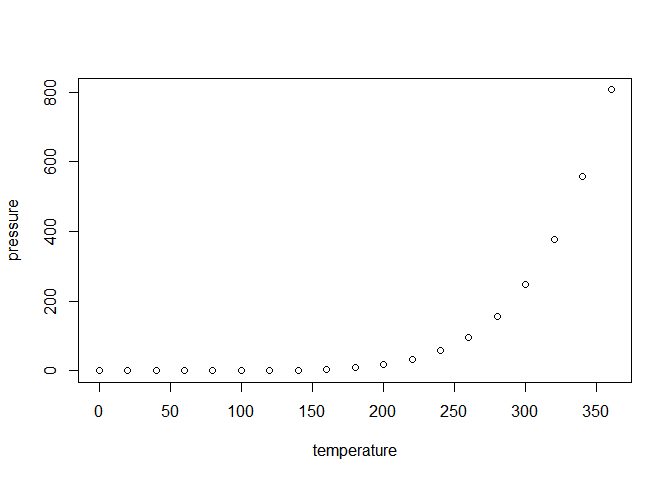

<!-- README.md is generated from README.Rmd. Please edit that file -->

# assignmentB2KeryanneGagnon

<!-- badges: start -->

<!-- badges: end -->

The goal of assignmentB2KeryanneGagnon is to allow users to count the
missing values in a data frame for all columns, except one which is used
to group the variables (and missing values).

## Installation

Package installation can be done directly by calling:

``` r
devtools::install_github("UBC-STAT545-F2026/assignmentB2KeryanneGagnon")
```

## Example

This is a basic example which shows you how to use the
`count_all_missing_by_group` function from the
`assignmentB2KeryanneGagnon` package:

``` r
library(assignmentB2KeryanneGagnon)
count_all_missing_by_group(airquality, Month)
#> # A tibble: 5 × 6
#>   Month Ozone Solar.R  Wind  Temp   Day
#>   <int> <int>   <int> <int> <int> <int>
#> 1     5     5       4     0     0     0
#> 2     6    21       0     0     0     0
#> 3     7     5       0     0     0     0
#> 4     8     5       3     0     0     0
#> 5     9     1       0     0     0     0
count_all_missing_by_group(airquality, Month, .groups = "keep")
#> # A tibble: 5 × 6
#> # Groups:   Month [5]
#>   Month Ozone Solar.R  Wind  Temp   Day
#>   <int> <int>   <int> <int> <int> <int>
#> 1     5     5       4     0     0     0
#> 2     6    21       0     0     0     0
#> 3     7     5       0     0     0     0
#> 4     8     5       3     0     0     0
#> 5     9     1       0     0     0     0
```

***DELETE everything after this line***\_ What is special about using
`README.Rmd` instead of just `README.md`? You can include R chunks like
so:

``` r
summary(cars)
#>      speed           dist       
#>  Min.   : 4.0   Min.   :  2.00  
#>  1st Qu.:12.0   1st Qu.: 26.00  
#>  Median :15.0   Median : 36.00  
#>  Mean   :15.4   Mean   : 42.98  
#>  3rd Qu.:19.0   3rd Qu.: 56.00  
#>  Max.   :25.0   Max.   :120.00
```

You’ll still need to render `README.Rmd` regularly, to keep `README.md`
up-to-date. `devtools::build_readme()` is handy for this.

You can also embed plots, for example:



In that case, don’t forget to commit and push the resulting figure
files, so they display on GitHub and CRAN.
